<!--
  💡 INTEGRATION INSTRUCTIONS:
  To display these banners on your GitHub profile:
  1. Upload "hero_dark.svg" and "hero_light.svg" to your GitHub profile repository (xvacorx/xvacorx).
  2. If you upload them to the root directory, leave the paths in the <picture> tag as is.
     If you upload them inside a folder (e.g. "gamedev_version"), update the paths in the tag to:
     srcset="gamedev_version/hero_dark.svg", srcset="gamedev_version/hero_light.svg", and src="gamedev_version/hero_dark.svg".
-->

<div align="center">
  <picture>
    <source media="(prefers-color-scheme: dark)" srcset="hero_dark.svg">
    <source media="(prefers-color-scheme: light)" srcset="hero_light.svg">
    
  </picture>

  <br><br>
  
  <h3>
    <code>[ SELECT PROFILE MODE ]</code><br>
    <a href="#english">🇺🇸 English</a> | <a href="#español">🇪🇸 Español</a>
  </h3>
</div>

---

<details open>
<summary id="english"><b>📂 us-English/game_mode.sav</b></summary>
<br>

## 🎮 LEVEL 1: Vik's Profile Status

I am a game designer and systems developer passionate about crafting responsive, immersive gameplay experiences. I lead my independent studio, **[Chroma Cat Studios](https://xvacorx.itch.io/)**, as Director / CEO & Lead Game Designer, focusing on casual puzzle loops, tactile Touch UX, and data-informed level design for titles like *[Toading Home](https://play.google.com/store/apps/details?id=com.ChromaCatStudios.ToadingHome)* (now live on the Google Play Store).

In parallel, I explore Local-First web utilities and digital tools at **[VikLabs](https://viklabs.pages.dev/)**. By day, I combine programming logic with infrastructure engineering: managing virtualized environments on Proxmox, designing Zero-Trust Mesh VPNs, building PowerShell automation suites, and collaborating with my custom AI partner **Jarvis** for rapid prototyping.

---

## ⚔️ QUEST LOG: Toolbox Tecnico Pro

I built a bulletproof, multi-OS command-line utility belt for Windows SysAdmins and Field Techs. It features zero-touch maintenance, bloatware removal, and smart diagnostics. 

Run it directly from an elevated PowerShell terminal:

```powershell
# Run the toolbox utility belt
irm tinyurl.com/VikToolBox | iex
```

* 📦 **Offline Executable**: [Download Toolbox.exe](https://downgit.github.io/#/home?url=https://github.com/xvacorx/BATman/blob/main/Toolbox/Toolbox.exe)
* 📂 **Source Code & Scripts**: Visit the [BATman Repository](https://github.com/xvacorx/BATman)

---

## 🎒 INVENTORY: Core Skills & Tools

```yaml
Game Development:
  - Unity 6 Engine (URP 2D & 3D)
  - C# Scripting & Architecture
  - Game & Level Design
  - Touch UX & Game Feel (Juiciness)
  - Telemetry & Analytics (GA4)
  - AI-Assisted Rapid Prototyping
IT & Systems:
  - PowerShell & Python Automation
  - Proxmox Virtualization (ZFS Mirror)
  - Zero-Trust Mesh VPN (NetBird)
  - ITSM & ITAM Orchestration (GLPI)
Productivity & Org:
  - Obsidian (Personal Wiki)
  - Git & GitHub Desktop
  - International Team Leadership (Scouts)
```

---

## 🌟 QUEST REWARDS: Featured Projects

*   🐸 **[Toading Home](https://play.google.com/store/apps/details?id=com.ChromaCatStudios.ToadingHome)** — Mobile precision grid-puzzle platformer published on the Google Play Store. Features real-time dual-dimension switching, momentum leaps, tactile bullet-time, and live GA4 telemetry.
*   🫧 **[Bubble Blowdown](https://marioldd.itch.io/bubbleblowdown)** — Competitive 2-player local arcade duel made for Global Game Jam 2025. Platform-ejection brawler featuring a strategic air/stamina resource bar.
*   🚀 **[Neon Shooter](https://xvacorx.itch.io/neon-shooter)** — Retro arcade top-down bullet hell shooter where 100% of game assets (player, enemies, bullets, power-ups) were crafted repurposing flat UI vector icons.
*   🎲 **[DiceMentions](https://xvacorx.itch.io/dicementions)** — Fast-paced top-down action shooter (Hotline Miami style) for Game Lab Rosario. Rolling dice dynamically dictates your weapon, enemy wave, and boss encounter.
*   🌐 **[VikLabs](https://viklabs.pages.dev/)** — Personal digital laboratory of Local-First web utilities (Instagram Cleaner via IndexedDB, interactive NetBird Mesh VPN simulator, theme inspector).

---

## 🎲 SIDE QUESTS: Hobbies & Interests

*   **Aesthetics:** Cyberpunk, Synthwave, Solarpunk, and Steampunk.
*   **Tabletop:** Huge fan of board games and card games.
*   **Scouting:** 15+ years of active leadership in Scouts de Argentina; international delegations in USA (World Scout Jamboree 2019) and Portugal (World Scout Moot 2025).
*   **Animals:** Red pandas, foxes, and black cats! 🐈‍⬛

---

## 🔗 COOP MODE: Connect & Party Up

```bash
- Google Play Store: Link (https://play.google.com/store/apps/details?id=com.ChromaCatStudios.ToadingHome)
- VikLabs Digital Lab: Link (https://viklabs.pages.dev/)
- LinkedIn Network: Link (https://www.linkedin.com/in/victor-g-sanchez/)
- Itch.io Studio Portal: Link (https://xvacorx.itch.io/)
- GitHub Repository Logs: Link (https://github.com/xvacorx)
```

[](https://play.google.com/store/apps/details?id=com.ChromaCatStudios.ToadingHome)
[](https://viklabs.pages.dev/)
[](https://www.linkedin.com/in/victor-g-sanchez/)
[](https://xvacorx.itch.io/)
[](https://github.com/xvacorx)

</details>

<br>

<details open>
<summary id="español"><b>📂 es-Español/game_mode.sav</b></summary>
<br>

## 🎮 NIVEL 1: Estado del Perfil de Vik

Soy un diseñador y desarrollador de videojuegos apasionado por crear experiencias inmersivas y responsivas. Lidero mi estudio independiente, **[Chroma Cat Studios](https://xvacorx.itch.io/)**, como Director / CEO & Lead Game Designer, enfocándome en loops de puzzle casual, Touch UX táctil y diseño de niveles basado en métricas para títulos como *[Toading Home](https://play.google.com/store/apps/details?id=com.ChromaCatStudios.ToadingHome)* (publicado en Google Play Store).

En paralelo, desarrollo utilidades web Local-First y herramientas digitales en **[VikLabs](https://viklabs.pages.dev/)**. En mi faceta técnica, fusiono la lógica de programación con la ingeniería de infraestructura: gestionando entornos virtualizados en Proxmox, diseñando redes Mesh VPN Zero-Trust, suites de automatización en PowerShell y colaborando con mi compañero de IA personalizado **Jarvis** para prototipado rápido.

---

## ⚔️ BITÁCORA DE MISIONES: Toolbox Técnico Pro

Desarrollé una navaja suiza para la línea de comandos, blindada y compatible con múltiples versiones de Windows para SysAdmins y técnicos de campo. Incluye mantenimiento desatendido, eliminación de bloatware y diagnósticos inteligentes.

Ejecútala directamente desde una terminal de PowerShell con privilegios elevados:

```powershell
# Ejecutar caja de herramientas
irm tinyurl.com/VikToolBox | iex
```

* 📦 **Ejecutable Portable**: [Descargar Toolbox.exe](https://downgit.github.io/#/home?url=https://github.com/xvacorx/BATman/blob/main/Toolbox/Toolbox.exe)
* 📂 **Código Fuente y Scripts**: Visita el [Repositorio BATman](https://github.com/xvacorx/BATman)

---

## 🎒 INVENTARIO: Habilidades & Herramientas

```yaml
Desarrollo de Videojuegos:
  - Motor Unity 6 (URP 2D & 3D)
  - Programación y Arquitectura C#
  - Game & Level Design
  - Touch UX & Game Feel (Juiciness)
  - Telemetría & Analítica (GA4)
  - Prototipado Rápido Asistido por IA
IT y Sistemas:
  - Automatización con PowerShell y Python
  - Virtualización Proxmox (ZFS Mirror)
  - Redes Mesh VPN Zero-Trust (NetBird)
  - Orquestación ITSM & ITAM (GLPI)
Productividad y Organización:
  - Obsidian (Wiki Personal)
  - Git & GitHub Desktop
  - Liderazgo de Equipos Internacionales (Scouts)
```

---

## 🌟 RECOMPENSAS DE MISIÓN: Proyectos Destacados

*   🐸 **[Toading Home](https://play.google.com/store/apps/details?id=com.ChromaCatStudios.ToadingHome)** — Juego mobile de puzzles y precisión en cuadrícula publicado en Google Play Store. Mecánica de alternancia dimensional en tiempo real, saltos por inercia, bullet-time táctil y telemetría en vivo vía GA4.
*   🫧 **[Bubble Blowdown](https://marioldd.itch.io/bubbleblowdown)** — Duelo arcade competitivo local para 2 jugadores creado para Global Game Jam 2025. Brawler de empuje fuera de plataforma con barra estratégica de aire/estamina.
*   🚀 **[Neon Shooter](https://xvacorx.itch.io/neon-shooter)** — Bullet-hell arcade retro donde el 100% de los elementos visuales (jugador, enemigos, proyectiles, mejoras) fueron diseñados reutilizando iconos vectoriales planos de UI.
*   🎲 **[DiceMentions](https://xvacorx.itch.io/dicementions)** — Action shooter frenético de vista aérea (estilo Hotline Miami) creado para Game Lab Rosario. La tirada de dados determina dinámicamente tu arma, la oleada de enemigos y el jefe final.
*   🌐 **[VikLabs](https://viklabs.pages.dev/)** — Laboratorio digital personal de utilidades web Local-First (Limpiador de exportaciones de Instagram vía IndexedDB, simulador interactivo de Mesh VPN NetBird, inspector de temas).

---

## 🎲 MISIONES SECUNDARIAS: Hobbies e Intereses

*   **Estéticas:** Cyberpunk, Synthwave, Solarpunk y Steampunk.
*   **Juegos de Mesa:** Fanático de los juegos de mesa y de cartas.
*   **Movimiento Scout:** Más de 15 años de liderazgo activo en Scouts de Argentina; delegaciones internacionales en EE.UU. (World Scout Jamboree 2019) y Portugal (World Scout Moot 2025).
*   **Animales:** Pandas rojos, zorros y gatos negros. 🐈‍⬛

---

## 🔗 MODO COOPERATIVO: Contacto & Conectarse

```bash
- Google Play Store: Enlace (https://play.google.com/store/apps/details?id=com.ChromaCatStudios.ToadingHome)
- VikLabs Laboratorio Digital: Enlace (https://viklabs.pages.dev/)
- Red LinkedIn: Enlace (https://www.linkedin.com/in/victor-g-sanchez/)
- Portal Itch.io: Enlace (https://xvacorx.itch.io/)
- Registro de GitHub: Enlace (https://github.com/xvacorx)
```

[](https://play.google.com/store/apps/details?id=com.ChromaCatStudios.ToadingHome)
[](https://viklabs.pages.dev/)
[](https://www.linkedin.com/in/victor-g-sanchez/)
[](https://xvacorx.itch.io/)
[](https://github.com/xvacorx)

</details>
